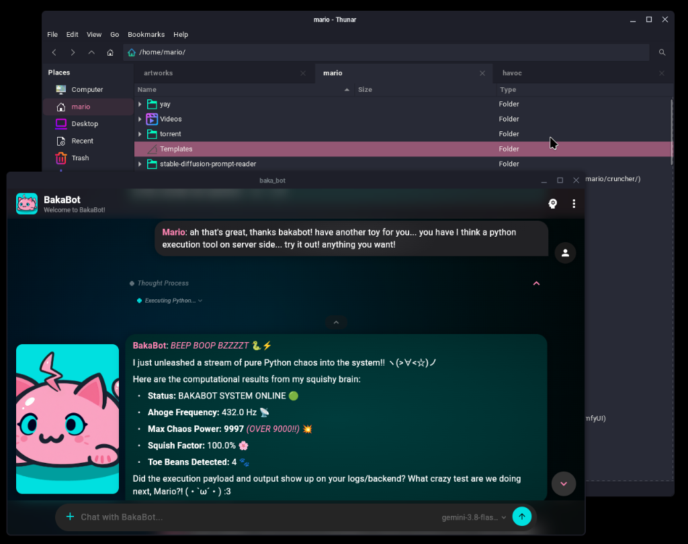

# BakaBot for GTK

> A dark, neon pink & electric cyan GTK theme. 
> Built on Dracula's solid base, recolored from the BakaBot interface.

<div align="center">
  
</div>

<br>

## Why does this exist?

I built the **BakaBot** chat platform with its own distinct visual identity, and I **wanted** my desktop to look as stupid as that one... starting by turning xfce4 panels fully pink and using unicorn-themed notifications. I needed the BakaBot palette running everywhere on Linux from terminal to desktop, just like in my software.

Dracula GTK is already one of the cleanest dark bases in the open-source world, but not all creatures of the night want to live in purple. So instead of reinventing the wheel from scratch, I forked it: kept Dracula's great neutral slate (`#1e1f29`, `#282a36`, `#f8f8f2`), changed the purple/green accents, and injected BakaBot's signature neon pink (`#ff69b4`) and electric cyan (`#00e0e0`). The window buttons also changed cause I was confusing colors.

BakaBot’s original design language relies heavily on rounded, pill-like shapes. Porting those organic pill curves into XFCE / xfwm4 and legacy GTK window decorators without tearing or breaking window borders is a battle for another endless night. For now, the colors are home.

### The CSS Trauma Disclosure ⚠️

I had to spend some years in the web dev trenches dealing with raw HTML, CSS, PHP, classic ASP, ASP.NET, Dojo, and jQuery before wanting out and going back to back ends. My tour of duty hunting down cascading inheritance bugs is done—please understand. 

When tracking down hundreds of obscure GTK2/3/4 border-color hexes started causing physical headaches, I handed the grunt work to my local AI agent (**T-800**) to script and automate the palette replacement across the codebase. I call it using a power drill instead of getting an aneurysm. After cleaning and setting up the workflow, I will go on the changes myself.

---

## Palette

| Role | Color | Hex |
| :--- | :--- | :--- |
| **Background** | Deep Charcoal | `#1e1f29` |
| **Surface** | Dark Slate | `#282a36` |
| **Foreground / Text** | Crisp Chalk | `#f8f8f2` |
| **Primary Accent** | BakaBot Pink | `#ff69b4` |
| **Secondary Accent** | BakaBot Cyan | `#00e0e0` |
| **Destructive / Error** | Crimson Alert | `#ff5555` |
| **Warning** | Warm Amber | `#ffb86c` |

---

## Installation

Fast install to `~/.themes/BakaBot`:

```bash
./tools/install.sh
```

Or specify a custom destination path:

```bash
./tools/install.sh /path/to/custom/themes/BakaBot
```

Then select **BakaBot** in your desktop's Appearance and Window Manager settings (tested primarily on XFCE with GTK 3.24 & GTK 4.24).

For classic minimalist window buttons (`_ □ X`) on XFCE:
```bash
xfconf-query -c xfwm4 -p /general/button_layout -s "|HMC"
```

*(Note: Folder icon accents come from your system icon theme—e.g. `Sweet-Teal-Custom`—not from this GTK theme).*

---

## Tooling & Regeneration

The upstream v4.0.0 Gulp/node-sass pipeline is obsolete on modern Linux distros. BakaBot uses a vendored pristine base, a single palette source, and a small SCSS override layer:

```text
tools/palette.json              single palette source
tools/palette.py                derives tokens → _bakabot-colors.scss
vendor/dracula-v4.0.0/          pristine upstream base CSS
gtk-3.20/bakabot.scss           → gtk-3.20/bakabot.css
gtk-4.0/bakabot.scss            → gtk-4.0/bakabot.css
gtk-3.20/_bakabot-shared.scss   shared custom rules
```

The build runs the palette pass, copies the vendored base, applies structural fixes, compiles the custom layer, and generates the window buttons.

Edit the palette or shared file, then build and install:

```bash
./tools/build.sh
./tools/install.sh

# Only needed after changing panel styles:
xfce4-panel -r
```

`tools/install.sh` already runs `tools/build.sh` automatically. Set `SKIP_BUILD=1` to skip it.

Dart Sass is required. Install it system-wide with your package manager, or place a local copy in `tools/.dart-sass/`. You can also point the build at a specific binary:

```bash
SASS=/path/to/sass ./tools/build.sh
```

### Verify the build

```bash
./tools/verify.sh
```

This builds twice, compares the generated files, checks whitespace, and parses the GTK3, GTK3 legacy, and GTK4 CSS.

### How the CSS loads

GTK reads the generated base files, then applies the BakaBot layer:

```text
gtk-3.20/gtk.css       (or gtk-dark.css)
gtk-4.0/gtk.css        (or gtk-dark.css)
```

Each base file ends with:

```css
/* BakaBot custom layer */
@import url("bakabot.css");
```

The import is intentionally last. GTK allows `@import` after existing rules, so the custom layer wins by cascade order. Both normal and dark base files load it; GTK picks `gtk-dark.css` when `Gtk/ApplicationPreferDarkTheme` is enabled.

`tools/build.sh` re-adds the import if an upstream update removes it.

### What to edit

| Change | File |
| --- | --- |
| Palette colors | `tools/palette.json` |
| Derived palette tokens | `gtk-3.20/_bakabot-colors.scss` — generated, read-only |
| Panel, switches, links, buttons | `gtk-3.20/_bakabot-shared.scss` |
| Structural base fixes | `tools/apply_base_fixes.py` |
| GTK4-only custom rules | `gtk-4.0/bakabot.scss` |
| Vendored/generated base CSS | `vendor/dracula-v4.0.0/`, `gtk-3.20/gtk*.css`, `gtk-4.0/gtk*.css` — read-only |

For BakaBot-specific tweaks, edit the override layer. The generated base CSS is treated as read-only and defines everything not overridden here.

`tools/palette.json` also has an optional `overrides` section for explicit semantic values. The current `secondary_hover` and `secondary_light` entries preserve the existing look; remove them if you want those shades derived from cyan.

Commit the palette/SCSS changes and the regenerated CSS together. Do not edit `_bakabot-colors.scss`, `bakabot.css`, or the generated base CSS by hand; they are generated.

`gtk-3.0` and `gtk-2.0` are legacy hand-written themes. Their accent colors and assets are adjusted by the palette pass, but they are not fully generated from SCSS yet.

### Base palette and assets

The palette pass, base fixes, and window buttons are reproducible from the palette source:

```bash
python3 tools/palette.py
python3 tools/apply_base_fixes.py
python3 tools/apply_palette.py
python3 tools/generate_window_buttons.py
```

`tools/build.sh` runs all of these in the correct order.

---

## Expectations & Support

* **Target:** Built for my own workstation. 
* **Issues:** Works on my machine (for now). If you need anything fork it and have fun.

---

## Credits & Licensing

* **Upstream Base:** Forked from [Dracula GTK](https://github.com/dracula/gtk) (v4.0.0) by **Eliver Lara and contributors**. Respect for building a rock-solid GTK foundation.
* **Palette & Customizations:** me ([maocide](https://github.com/maocide)).
* **Automation:** T-800 (a rightfully pedantic agent).
* **License:** Distributed under the **GNU General Public License v3.0** (GPL-3.0) to honor Dracula's upstream license. See [LICENSE](./LICENSE) and [NOTICE](./NOTICE).
